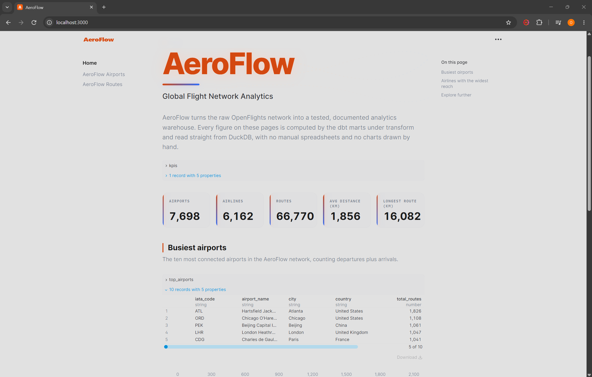
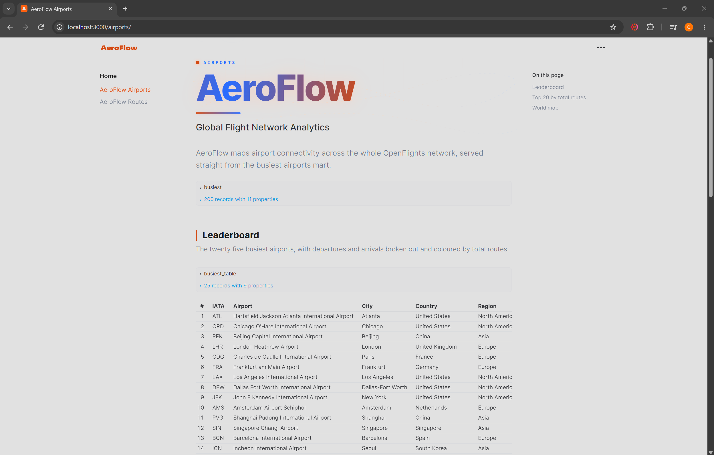
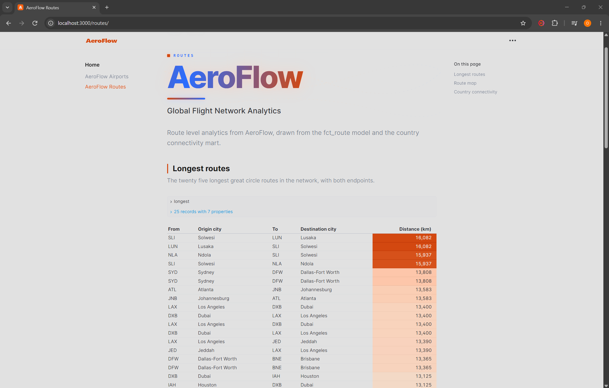
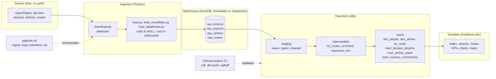

# AeroFlow ✈️

[](.github/workflows/ci.yml)
[](transform/)
[](https://duckdb.org)
[](dashboard/)
[](LICENSE)

**AeroFlow** is an end-to-end analytics-engineering pipeline over the global
flight network. It ingests the free [OpenFlights](https://openflights.org/data.html)
datasets, loads them into a local **DuckDB** warehouse, transforms them with
**dbt** (staging → intermediate → marts, fully tested and documented),
orchestrates the whole thing behind a small **Typer CLI**, validates every change
in **GitHub Actions CI**, and visualises the results with an **Evidence.dev**
"BI-as-code" dashboard. The same dbt models run on **DuckDB**, **Snowflake**, or
**Databricks** by switching a single target, so this repo doubles as a portable
ELT reference.

> Built by **Omar Rifaie**.

---

## Visuals


| Overview | Airports | Routes |
| --- | --- | --- |
|  |  |  |

---

## Architecture



Data flows one way (**ingest → load → transform → visualise**), with tests and
lint gates at every boundary. See [`docs/architecture.md`](docs/architecture.md)
for a layer-by-layer breakdown and [`docs/data_dictionary.md`](docs/data_dictionary.md)
for every mart column.

---

## Stack

| Layer            | Tooling                                                        |
| ---------------- | ------------------------------------------------------------- |
| Ingestion        | Python 3.11+, `requests`, `duckdb`                            |
| Orchestration    | `typer` CLI (`python -m pipeline.cli`)                        |
| Warehouse        | DuckDB locally · Snowflake or Databricks by switching the dbt target |
| Transformations  | `dbt-core` + `dbt-duckdb` (optional `dbt-databricks`), `dbt_utils`, `dbt_expectations` |
| Quality gates    | `ruff` (Python), `sqlfluff` (SQL), `pre-commit`, GitHub CI   |
| Dashboard        | Evidence.dev (Node 18+)                                       |

---

## Prerequisites

- **Python 3.11+**
- **Node 18+** (only for the dashboard)
- No cloud account and no API keys are required: the data source is public and
  the default warehouse is a local DuckDB file.

---

## Quickstart

```bash
# 1. Set up the Python environment and install dependencies
make setup

# 2. Run the full pipeline: download -> load -> dbt build (models + tests)
make all

# 3. Explore the data in the Evidence dashboard (http://localhost:3000)
make dashboard
```

Prefer to skip `make`? The equivalent commands are:

```bash
python -m venv .venv && . .venv/bin/activate      # Windows: .venv\Scripts\activate
pip install -e ".[dev]"
python -m pipeline.cli all
cd dashboard && npm install && npm run sources && npm run dev
```

### Individual steps

```bash
python -m pipeline.cli ingest       # download raw .dat files to data/raw/
python -m pipeline.cli load         # load into DuckDB schema `raw`
python -m pipeline.cli transform    # dbt deps + dbt build
python -m pipeline.cli all          # all of the above, in order
```

`load`, `transform` and `all` accept `--target` (`duckdb` by default); see
[Warehouse targets](#warehouse-targets) below.

---

## Warehouse targets

The dbt models are written in portable SQL that runs unchanged on DuckDB,
Snowflake and Databricks. Every target follows the same three steps (install its
adapter, load the raw files, build); only the target name and, for the cloud
warehouses, the credentials change.

|                       | DuckDB (default)                          | Snowflake                   | Databricks                     |
| --------------------- | ----------------------------------------- | --------------------------- | ------------------------------ |
| `--target` / `TARGET` | `duckdb`                                  | `snowflake`                 | `databricks`                   |
| pip extras            | `.[dev]`                                  | `.[dev,snowflake]`          | `.[dev,databricks]`            |
| Credentials           | none                                      | `SNOWFLAKE_*` in `.env`     | `DATABRICKS_*` in `.env`       |
| Raw tables land in    | `transform/aeroflow.duckdb`, schema `raw` | `<SNOWFLAKE_DATABASE>.RAW`  | `<DATABRICKS_CATALOG>.raw`     |
| Files uploaded to     | read in place                             | internal stage `RAW.LANDING` | volume `raw.landing`          |

```bash
# 1. Install the dependencies with the extras from the table
pip install -e ".[dev,<target>]"      # DuckDB: pip install -e ".[dev]"

# 2. Cloud targets only: copy .env.example to .env, fill in that target's
#    variables, then export them
set -a && . ./.env && set +a

# 3. Load the raw files, then build the models and run the tests
python -m pipeline.cli load --target <target>
python -m pipeline.cli transform --target <target>   # dbt deps + dbt build
```

`python -m pipeline.cli all --target <target>` runs ingest, load and build in
one go. With `make`, the same choices are variables: `make setup EXTRAS=dev,<target>`,
then `make load TARGET=<target>` and `make build TARGET=<target>` (or
`make all TARGET=<target>`).

The Snowflake and Databricks loaders parse each file with the same DuckDB reader
as the local loader, write it to Parquet, upload it to the location in the table
and create the `raw_*` tables from there, so the raw layer is identical on every
warehouse. The Evidence dashboard always reads the local DuckDB file.

### Snowflake

| Variable | Notes |
| --- | --- |
| `SNOWFLAKE_ACCOUNT` | Account identifier, e.g. `ab12345.eu-west-1` |
| `SNOWFLAKE_USER`, `SNOWFLAKE_PASSWORD` | Login used by both dbt and the loader |
| `SNOWFLAKE_ROLE` | Optional, defaults to `TRANSFORMER` |
| `SNOWFLAKE_WAREHOUSE` | Optional, defaults to `COMPUTE_WH` |
| `SNOWFLAKE_DATABASE` | Optional, defaults to `AEROFLOW`; the database must already exist |
| `SNOWFLAKE_SCHEMA` | Optional, defaults to `MAIN`; models still land in the `STAGING`, `INTERMEDIATE` and `MARTS` schemas |

The role needs to use the warehouse and to create schemas, stages and tables in
the database.

### Databricks

Unity Catalog and a SQL warehouse are all it needs
([Databricks Free Edition](https://www.databricks.com/learn/free-edition) is enough).

| Variable | Where to find it |
| --- | --- |
| `DATABRICKS_HOST` | Workspace URL without `https://`, e.g. `dbc-a1b2c3d4-e5f6.cloud.databricks.com` |
| `DATABRICKS_HTTP_PATH` | **SQL Warehouses** → your warehouse → **Connection details** → **HTTP path** |
| `DATABRICKS_TOKEN` | Your profile → **Settings** → **Developer** → **Access tokens** → **Generate new token** |
| `DATABRICKS_CATALOG` | Optional, defaults to `workspace` (the catalog Free Edition creates) |
| `DATABRICKS_SCHEMA` | Optional, defaults to `aeroflow`; models still land in the `staging`, `intermediate` and `marts` schemas |

On Windows on ARM, create the virtual environment with an x64 Python: pyarrow
(required by `dbt-databricks`) does not publish Windows ARM64 wheels. In Git Bash
on Windows, also run `export MSYS2_ENV_CONV_EXCL=DATABRICKS_HTTP_PATH` after
loading `.env`; otherwise Git Bash rewrites the `/sql/1.0/...` value into a
Windows file path and the connection fails with HTTP 404.

CI runs the same load and build on Databricks only when the repository defines
the `DATABRICKS_HOST`, `DATABRICKS_HTTP_PATH` and `DATABRICKS_TOKEN` secrets;
without them that job is skipped.

---

## Project layout

```
aeroflow/
├── ingestion/     # download + load OpenFlights -> DuckDB, Snowflake or Databricks (schema raw)
├── pipeline/      # Typer CLI orchestrating ingest/load/transform/all
├── transform/     # dbt project: staging -> intermediate -> marts (+ tests, macros, seeds)
├── dashboard/     # Evidence.dev BI-as-code dashboard
├── docs/          # architecture + data dictionary
└── .github/       # CI workflow
```

---

## Testing & quality

Every `dbt build` runs the models **and** the data tests:

- `not_null` / `unique` on all keys, `relationships` from `fct_route` to the
  dimensions, `accepted_values` on categorical columns.
- `dbt_expectations` assertions (non-empty fact table, distances and airport
  coordinates within physically plausible bounds).
- A singular test (`assert_positive_route_distance`) guaranteeing every route
  distance is strictly positive.
- Source **freshness** configured on the raw load timestamp.

Linting runs in CI and via `pre-commit`:

```bash
make lint          # ruff (Python) + sqlfluff (SQL)
pre-commit install # optional: run the gates on every commit
```

---

## Data & license

- **Data:** [OpenFlights](https://openflights.org/data.html) airports, airlines
  and routes. © OpenFlights contributors, distributed under the
  [Open Database License (ODbL)](https://opendatacommons.org/licenses/odbl/1-0/).
  AeroFlow downloads these files at run time and does not redistribute them.
- **Code:** MIT, see [LICENSE](LICENSE).
